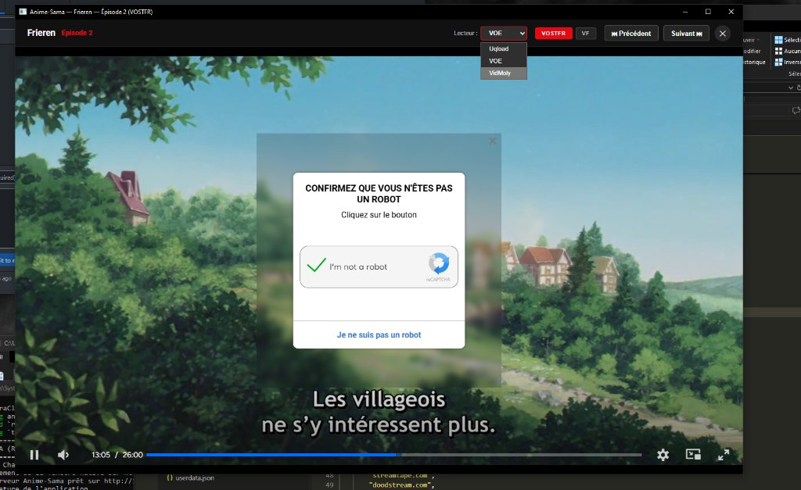

# Anime-Sama Desktop

A fast, lightweight native desktop application written in Rust that provides a Netflix-style interface for streaming anime, scans, and webtoons from Anime-Sama.



## Features

- **Netflix-Style Interface**: Hero billboard with featured titles, horizontal category rails, smooth navigation, and video trailer previews on hover with volume control.
- **Embedded Video Player**: Integrated cinema player with episode navigation, season selector, hoster switching, and fullscreen support.
- **Built-in Ad Shield**: Local reverse proxy blocking intrusive redirects, popups, and tracker scripts from third-party video hosts (VOE, VidMoly, Uqload).
- **Internationalization (i18n)**: 10 built-in languages (French, English, Japanese, Spanish, German, Italian, Portuguese, Arabic, Russian, Korean) plus custom `.lang` file support.
- **Isolated Storage**: Watchlist, watch history, and session tokens are stored in the user data directory (`%LOCALAPPDATA%\AnimeSama` on Windows, `~/.local/share/AnimeSama` on Linux) to prevent sensitive data leaks.
- **Cloud Account Sync**: Optional login to anime-sama.to with bidirectional progress and favorites synchronization.
- **In-App Auto-Updater**: Automatic background release checks against GitHub Releases with one-click direct update installation.
- **Minimal Resource Usage**: Self-contained Rust binary consuming under 40 MB of RAM with zero Electron or Node.js runtime overhead.

## Installation

Precompiled binaries and packages are available on the [Releases](https://github.com/Cataclyse/AnimeSama/releases) page.

### Windows

Download `animesama.exe` or `animesama-windows-x86_64.zip`, extract if needed, and run the executable.

### Linux (Debian / Ubuntu / Linux Mint)

Download the `.deb` package and install it via `apt`:

```bash
sudo apt install ./animesama_0.1.0_amd64.deb
```

This installs the binary to `/usr/bin/animesama`, registers system dependencies (`libwebkit2gtk-4.1-0`, `libgtk-3-0`), and adds Anime-Sama to your desktop application menu with its official icon.

### Linux (Portable Standalone)

- **Desktop GUI**: `animesama-linux-gui` (requires `libwebkit2gtk-4.1-0` and `libgtk-3-0`)
- **Headless / Server**: `animesama-linux-server` (zero C/WebKitGTK dependencies, runs on any Linux distribution and serves the UI over HTTP)

```bash
chmod +x animesama-linux-gui
./animesama-linux-gui
```

## Building from Source

### Prerequisites

- **Rust toolchain** (1.75+): Install via [rustup.rs](https://rustup.rs)
- **Linux dependencies** (for native GUI build):
  - Debian / Ubuntu: `sudo apt install libwebkit2gtk-4.1-dev libgtk-3-dev libsoup-3.0-dev libjavascriptcoregtk-4.1-dev build-essential`
  - Arch Linux: `sudo pacman -S webkit2gtk-4.1 gtk3 base-devel`
  - Fedora: `sudo dnf install webkit2gtk4.1-devel gtk3-devel`

### Build & Run

Standard desktop window (WebView2 on Windows, WebKitGTK on Linux):

```bash
cargo run --release
```

Browser mode (launches the local server and opens your default web browser):

```bash
cargo run --release -- --browser
```

Headless server mode (for remote VPS or background service without GUI):

```bash
cargo run --release -- --headless
```

To compile without GTK/WebKit dependencies (pure server build for older Linux distros):

```bash
cargo build --release --no-default-features
```

## Project Layout

- `src/main.rs`: Entry point, CLI argument parsing, window lifecycle (`Tao` and `Wry`).
- `src/adblock/`: Ad Shield filtering rules and popup sanitization.
- `src/catalogue/`: Catalogue scrapers, categories, and trailer resolvers.
- `src/proxy/`: Local streaming reverse proxy and iframe unblocking.
- `src/scraper/`: Anime-Sama real-time metadata parser (seasons, episodes, hosts).
- `src/server/`: Multi-threaded HTTP server (`tiny_http`), REST API endpoints, and embedded static assets.
- `src/update/`: GitHub Releases auto-update checker and self-installer.
- `src/user/`: Profile management, Anime-Sama cloud auth, and XDG/AppData paths.
- `static/`: Frontend interface (Netflix CSS theme, vanilla JavaScript modules, and `.lang` translation files).

## License

This project is licensed under the **MIT License**. You are free to use, modify, and redistribute this software provided that the original copyright notice and author credits are retained in all copies or substantial portions of the software. See [LICENSE](LICENSE) for details.
